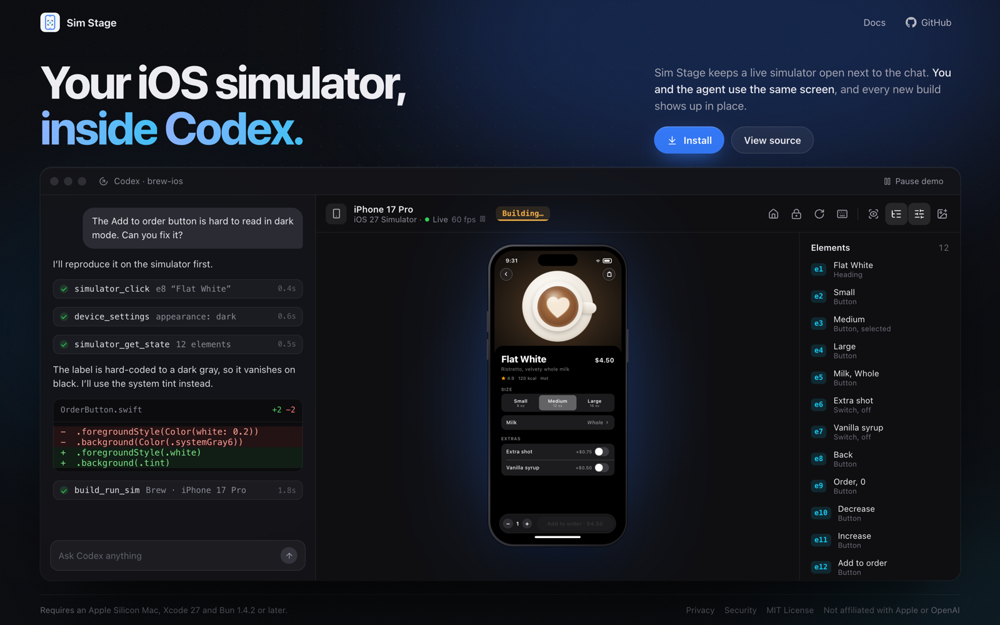

# Sim Stage

View and control an Apple simulator beside a Codex chat. You and the agent use the same screen; the agent reads accessibility elements, acts on current targets and checks the result.

[Website](https://simstage.swellapp.app) · [Support](https://github.com/rishirsv/simstage/issues)



## Requirements

- Apple Silicon Mac, Bun 1.4.2 or later, Xcode 27 and an installed simulator runtime.
- Xcode open with **Settings → Intelligence → Model Context Protocol** enabled.
- A desktop host with local stdio MCP and MCP Apps support. Installation is unavailable on web and mobile.

Physical-device interaction requires pairing and Apple eligibility and remains unverified in this release. Live video is simulator-only. Simulator video uses hardware HEVC with H.264 fallback. The native helper targets macOS 14 or later; development checks run on macOS 27 and Xcode 27.

## Install

```sh
git clone https://github.com/rishirsv/simstage.git
cd simstage
bun install --frozen-lockfile
bun run dev:plugin
codex plugin marketplace add "$PWD/.dev-plugin" --json
codex plugin add sim-stage@sim-stage-dev --json
```

Start a new Codex chat and ask: "Open Sim Stage and show my available simulators." To update, rebuild and repeat the last two commands. This source installation uses the checkout's bundled runtime.

Use current accessibility refs for input and request `screenshot: "always"` for visual checks. The [simulator skill](plugins/sim-stage/skills/drive-simulator/SKILL.md) covers selection, snapshots, settings and cleanup. Sim Stage does not build apps or generate SwiftUI previews.

Use development apps and sample data. Screens, element text and tool arguments can reach the assistant. Secure-field text is redacted and secure typing is blocked; screenshot and video pixels are not redacted. Restore temporary settings and disconnect when finished.

## Independent worktree previews

Device selection stays on the server serving your chat or preview. Opening another
chat does not join its device, and another worktree's selections do not move your
viewer. Connecting to a busy device returns `DEVICE_BUSY`; use another simulator
or explicitly pass `share: true` to `device_connect` when shared control is intended.
The viewer offers **Share control** after a busy-device refusal. Both participants
can send input. Sessions held by another tool still require `takeOver: true`.

For a browser preview tied to a worktree, build first, then run:

```sh
bun run preview --workspace /path/to/worktree --device DEVICE_UDID --label "Workout prototype"
```

Use a device ID from `sim_stage_status`. The launcher allocates an available
loopback port and prints JSON containing the actual URL, workspace, instance
identity and reuse status. `--port NUMBER` selects a specific port; `0` is the
default. `SIM_STAGE_PREVIEW_PORT` remains supported. Omit `--device` to choose in
the viewer. Workspace paths are canonicalized, so a symlink reuses the same
preview. Concurrent launches for that workspace reuse its verified running
instance; requesting a different device fails without changing the existing
preview. A command that reuses a preview exits and leaves its owner running.

The creating instance owns cleanup of disposable simulators. `simulator_delete`
refuses another creator or another active holder. Disconnect shared participants
before cleanup. After a creator stops, inspect the exact device ID and abandonment
status, then explicitly call `simulator_claim` to accept cleanup ownership. Legacy
creation records also require a claim. Personal devices can never be claimed.
Upgrade all participating Sim Stage processes to use these policies; this cannot
constrain other device tools or an older running plugin.

## Development

```sh
bun run typecheck
bun run build
bun test
bun run pack
bun run verify:packages
```

The submission ZIP is written to `release/` and verified from an isolated extraction directory. Native signing is ad-hoc, without Developer ID notarization. Edit `plugins/sim-stage/plugin.json`, then run `bun scripts/sync-version.mjs` to regenerate its Codex overlay. Keep generated builds, recordings and measurements out of Git.

For another local MCP client, build and run `bun packages/sim-stage-mcp/dist/server.js`; the root `.mcp.json` declares this command. `bun run preview` prints a loopback browser URL.

Source lives in `src/`, the native helper in `native/`, plugin metadata and assets in `plugins/sim-stage/`, and the Sites website in `sites/`.

[Privacy](PRIVACY.md) · [Terms](TERMS.md) · [Security](SECURITY.md)

MIT; see [LICENSE](LICENSE). Derived from [Max Weinbach's Apple simulator plugin](https://github.com/mweinbach/AppleSimChatGPTPlugin), with attribution in [NOTICE](NOTICE). Bundled dependency notices ship with the runtime. Maintained by Rishi Sharma; independent of Apple and OpenAI.
